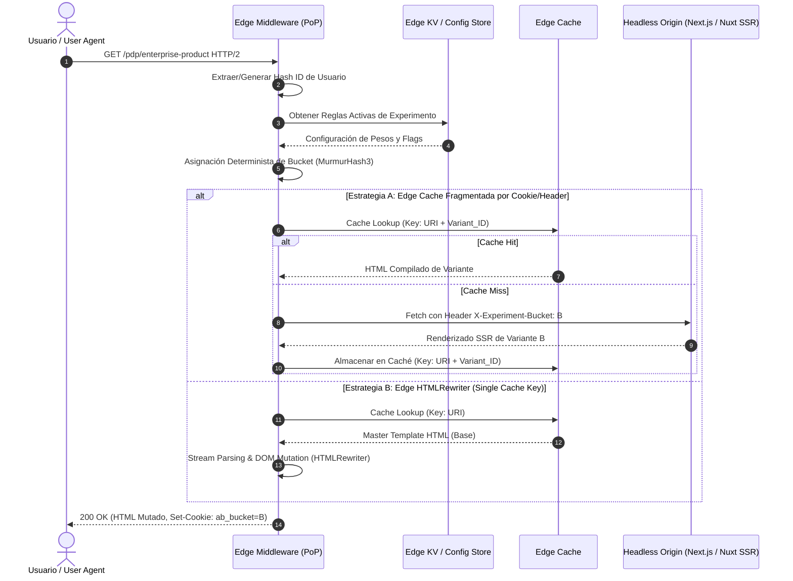
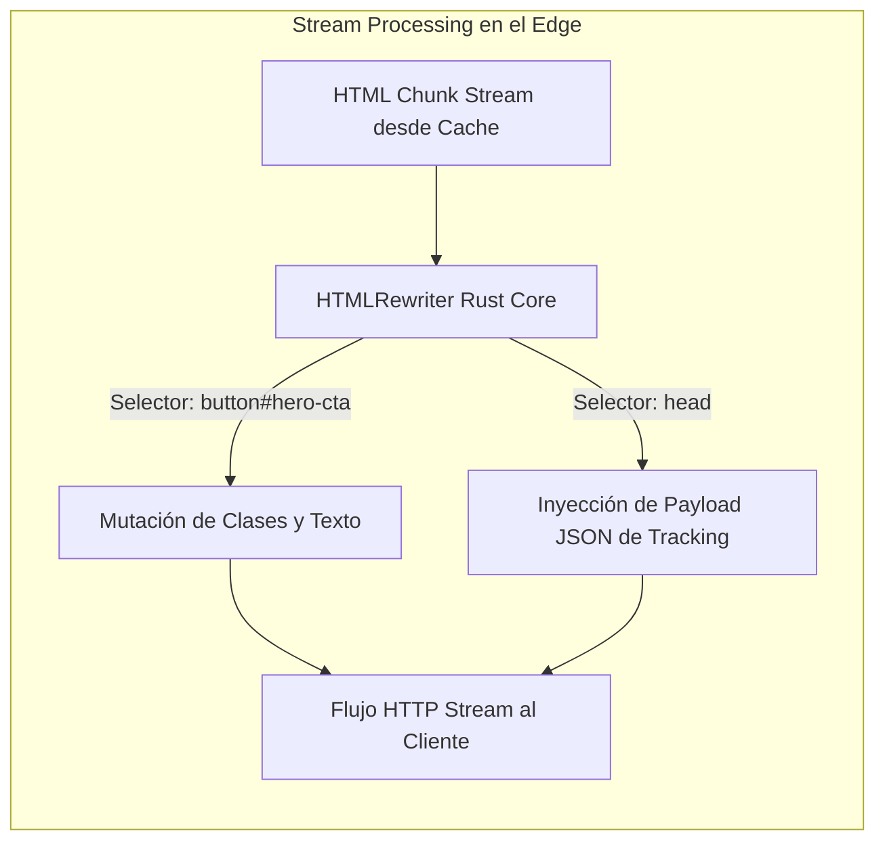

El despliegue de scripts tradicionales de experimentación del lado del cliente (client-side A/B testing) representa una de las fuentes más severas de degradación de Core Web Vitals en plataformas de comercio headless a gran escala. La inyección síncrona de librerías como Optimizely, VWO o Dynamic Yield bloquea el hilo principal de renderizado (*main thread execution*), mientras que la ejecución asíncrona induce de forma inevitable el efecto *Flash of Original Content* (FOOC). Este parpadeo visual genera picos de Cumulative Layout Shift (CLS) superiores a 0.28, degradando directamente el Page Experience Score en Google y provocando caídas cuantificables en tasas de conversión móvil.

Resolver este problema delegando la bifurcación al servidor de origen (SSR) tampoco escala de forma óptima: fragmenta la caché del CDN, destruye el *Cache Hit Ratio* (CHR) global y añade una latencia TTFB (*Time to First Byte*) inaceptable para audiencias distribuidas globalmente. La solución de ingeniería enterprise para este dilema consiste en ejecutar la evaluación determinista de variantes y la mutación del árbol de renderizado directamente en el PoP (*Point of Presence*) de la red Edge, interceptando el flujo HTTP antes de que el navegador comience la fase de análisis del DOM.

## El Trilema de la Experimentación en el Frontend Headless

La implementación de experimentación en arquitecturas MACH enfrenta un trilema técnico donde resulta complejo maximizar tres variables simultáneamente:

1. **Cero CLS y Zero-Flicker:** El usuario debe recibir el markup de la variante compilado en el primer frame de renderizado. No se toleran mutaciones por JavaScript post-hidratación.
2. **Latencia Sub-50ms (Edge Cache Hit Ratio > 90%):** Las páginas deben servirse desde cachés perimetrales sin penalizar el TTFB con *cold starts* de servidores de origen o ejecuciones de renderizado pesadas.
3. **Aislamiento Estadístico y Determinismo:** La asignación a buckets debe ser reproducible, resistente a borrados de cookies entre sesiones, compatible con políticas ITP (*Intelligent Tracking Prevention*) de navegadores modernos y transparente para rastreadores de motores de búsqueda.



Existen dos patrones arquitectónicos principales para resolver este flujo en el perímetro: el **Multi-Origin / Variant Key Routing** y el **Edge Streaming DOM Mutation con HTMLRewriter**.

---

## Patrón 1: Edge Routing y Cache Keys Segmentadas

En este patrón, el Middleware perimetral evalúa las cookies o genera una firma criptográfica del cliente, calcula la variante aplicable y manipula la clave interna de caché (*Cache Key*) agregando el identificador del experimento. Si el PoP no tiene el asset en memoria, invoca al backend SSR inyectando encabezados HTTP específicos.

### Implementación con Cloudflare Workers / Fastly Compute

El siguiente ejemplo en TypeScript implementa una asignación determinista basada en el algoritmo MurmurHash3 sin dependencias pesadas, normaliza bots para SEO y gestiona la caché perimetral sin invalidar las URLs canónicas.

```typescript
// edge-experiment-router.ts
import { murmur3 } from 'murmurhash-js';

interface ExperimentConfig {
  id: string;
  trafficAllocation: number; // 0.0 a 1.0
  variants: { name: string; weight: number }[];
}

const EXPERIMENT: ExperimentConfig = {
  id: 'exp_checkout_redesign_2026',
  trafficAllocation: 0.50, // 50% del tráfico total participa
  variants: [
    { name: 'control', weight: 50 },
    { name: 'variant_b', weight: 50 }
  ]
};

const BOT_USER_AGENTS = [
  'Googlebot',
  'Bingbot',
  'YandexBot',
  'DuckDuckBot',
  'Baiduspider'
];

export default {
  async fetch(request: Request, env: any, ctx: ExecutionContext): Promise<Response> {
    const url = new URL(request.url);

    // 1. Detección y aislamiento estricto de crawlers (SEO Cloaking Prevention)
    const userAgent = request.headers.get('user-agent') || '';
    const isBot = BOT_USER_AGENTS.some(bot => userAgent.includes(bot));

    if (isBot) {
      // Los motores de búsqueda siempre reciben la versión de control canónica
      return fetch(request);
    }

    // 2. Extracción o generación de identificador de usuario para determinismo
    const cookies = request.headers.get('Cookie') || '';
    let userId = getCookie(cookies, 'mach_uid');
    let isNewUser = false;

    if (!userId) {
      userId = crypto.randomUUID();
      isNewUser = true;
    }

    // 3. Evaluación determinista del Bucket (MurmurHash3)
    const assignedVariant = resolveBucket(userId, EXPERIMENT);

    // 4. Construcción de Cache Key Sintética en el Edge
    const cacheKeyUrl = new URL(request.url);
    cacheKeyUrl.searchParams.set(`__exp_${EXPERIMENT.id}`, assignedVariant);
    const cacheKey = new Request(cacheKeyUrl.toString(), request);
    const cache = caches.default;

    let response = await cache.match(cacheKey);

    if (!response) {
      // Fallback al origen: inyectamos headers para SSR o Static Storage Routing
      const originRequest = new Request(request);
      originRequest.headers.set('X-MACH-Experiment-ID', EXPERIMENT.id);
      originRequest.headers.set('X-MACH-Variant', assignedVariant);

      response = await fetch(originRequest);

      // Re-encapsular para permitir mutación de headers antes del cache
      response = new Response(response.body, response);
      response.headers.set('Vary', 'Accept-Encoding, X-MACH-Variant');
      response.headers.set('Cache-Control', 'public, max-age=60, s-maxage=600, stale-while-revalidate=86400');

      // Almacenamiento en caché perimetral bajo la clave particionada
      ctx.waitUntil(cache.put(cacheKey, response.clone()));
    }

    // 5. Clonación de respuesta para persistir la cookie de variante en el cliente
    const finalResponse = new Response(response.body, response);
    
    if (isNewUser) {
      finalResponse.headers.append(
        'Set-Cookie',
        `mach_uid=${userId}; Path=/; Max-Age=31536000; SameSite=Lax; Secure; HttpOnly`
      );
    }
    
    finalResponse.headers.set(
      'Set-Cookie',
      `mach_exp_${EXPERIMENT.id}=${assignedVariant}; Path=/; Max-Age=2592000; SameSite=Lax; Secure`
    );
    finalResponse.headers.set('X-Edge-Variant-Assigned', assignedVariant);

    return finalResponse;
  }
};

function resolveBucket(userId: string, experiment: ExperimentConfig): string {
  // Hash seed normalizada
  const hashValue = murmur3(`${userId}:${experiment.id}`) >>> 0;
  const normalizedScore = (hashValue % 10000) / 10000; // Valor entre 0.0000 y 0.9999

  // Verificar si califica para el experimento según trafficAllocation
  if (normalizedScore > experiment.trafficAllocation) {
    return 'control';
  }

  // Segmentación proporcional dentro de los participantes
  const internalScore = normalizedScore / experiment.trafficAllocation;
  let accumulatedWeight = 0;
  const totalWeight = experiment.variants.reduce((acc, v) => acc + v.weight, 0);

  for (const variant of experiment.variants) {
    accumulatedWeight += variant.weight / totalWeight;
    if (internalScore <= accumulatedWeight) {
      return variant.name;
    }
  }

  return 'control';
}

function getCookie(cookieHeader: string, name: string): string | null {
  const matches = cookieHeader.match(new RegExp(`(?:^|; )${name}=([^;]*)`));
  return matches ? decodeURIComponent(matches[1]) : null;
}
```

---

## Patrón 2: Edge Streaming Mutation con HTMLRewriter

Cuando el inventario de variantes difiere en elementos específicos de la interfaz (tales como micro-copias, componentes de llamada a la acción [CTA], bloques de precios o layouts de checkout) y no justifica mantener múltiples copias SSR en caché, la mutación en streaming por chunks representa el patrón más eficiente.

El motor `HTMLRewriter` procesa flujos HTML mediante parsers SAX implementados en Rust compilados a WebAssembly (C/Rust FFI), lo que permite mutar clases, atributos y texto a nivel de bytes en tiempo de tránsito sin decodificar todo el documento en memoria RAM ni penalizar el First Contentful Paint (FCP).



### Implementación de Mutación Zero-CLS con Streaming

```typescript
// edge-html-rewriter.ts
export class HeroVariantTransformer {
  private variant: string;

  constructor(variant: string) {
    this.variant = variant;
  }

  element(element: Element) {
    if (this.variant === 'variant_b') {
      // Modificación in-place de atributos
      element.setAttribute('class', 'btn btn-primary btn-lg bg-emerald-600 hover:bg-emerald-700 shadow-xl');
      element.setAttribute('data-mach-tested', 'true');
    }
  }

  text(textChunk: Text) {
    if (this.variant === 'variant_b' && textChunk.text.includes('Comprar Ahora')) {
      textChunk.replace('Adquirir Suscripción con 20% Desc.');
    }
  }
}

export class HeadMetadataTransformer {
  private experimentData: Record<string, string>;

  constructor(experimentData: Record<string, string>) {
    this.experimentData = experimentData;
  }

  element(element: Element) {
    // Inyección de estado para hidratación sin layout shift
    const script = `
      <script type="application/json" id="__EDGE_EXPERIMENT_STATE__">
        ${JSON.stringify(this.experimentData)}
      </script>
    `;
    element.append(script, { html: true });
  }
}

export async function handleStreamExperiment(
  request: Request, 
  response: Response, 
  variant: string
): Promise<Response> {
  // Inicialización de la canalización de streaming sin romper el Time To First Byte
  const rewriter = new HTMLRewriter()
    .on('a#main-cta-button', new HeroVariantTransformer(variant))
    .on('head', new HeadMetadataTransformer({
      experimentId: 'hero_conversion_v2',
      appliedVariant: variant,
      timestamp: Date.now().toString()
    }));

  // HTMLRewriter no bufferiza la página completa: procesa en tránsito
  return rewriter.transform(response);
}
```

Al inyectar el bloque JSON en el elemento `<head>`, la aplicación React o Vue en el cliente realiza la hidratación coincidiendo exactamente con el árbol DOM generado en el perímetro, eliminando advertencias como *Text content does not match server-rendered HTML* y suprimiendo cualquier salto estructural en la renderización.

---

## Matriz de Decisión Arquitectónica

La selección de la técnica de experimentación depende de los requisitos de caché, infraestructura y complejidad de los cambios visuales.

| Criterio | Client-Side Injection (Optimizely/VWO tradicional) | Server-Side SSR (Next.js/Remix en Origen) | Edge Dynamic Routing (PoP Variant Key) | Edge Streaming (HTMLRewriter) |
| :--- | :--- | :--- | :--- | :--- |
| **Impacto en CLS** | Crítico (> 0.25) | Cero (0.00) | Cero (0.00) | Cero (0.00) |
| **Penalización TTFB** | Mínima inicial (pero bloquea TBT) | Alta (+80ms - 300ms SSR origin hop) | Nula en Cache Hit (< 25ms) | Despreciable (< 5ms streaming) |
| **Impacto en Cache Hit Ratio** | Inmune (Caché estándar) | Severo (Destruye caché global) | Moderado (Divide caché por $N$ variantes) | Óptimo (1 clave para todas las variantes) |
| **Complejidad de Mutación** | Interfaz Gráfica (Baja) | Completa en Código (Alta) | Completa en Código (Alta) | Moderada (DOM / CSS / Atributos) |
| **Sobrecarga de Red (Payload)** | Alta (50KB - 200KB JS de terceros) | Cero overhead en runtime | Cero overhead en runtime | Cero overhead en runtime |
| **Riesgo de Parpadeo (FOOC)** | Muy Alto | Inexistente | Inexistente | Inexistente |

---

## Modos de Fallo Críticos en Operaciones de Día 2 y Mitigación

La ejecución de lógica condicional en la red de distribución introduce nuevos vectores de error distribuido que deben gobernarse sistemáticamente:

### 1. El Colapso de la Caché por "Vary Header Explosion"
Si se configura incorrectamente el encabezado `Vary: Cookie` en la respuesta perimetral, la infraestructura del CDN intentará almacenar una entrada única de caché por cada cookie individual presente en el request (incluyendo tokens de sesión, analítica y tracking).
* **Impacto:** Cache Hit Ratio se derrumba a valores inferiores al 5%, saturando las bases de datos y orígenes del backend headless.
* **Mitigación:** Desacoplar la caché pública de los encabezados de usuario. Utilizar una clave sintética perimetral basada exclusivamente en identificadores de variante normalizados (ej: `cacheKeyUrl.searchParams.set('__var', 'b')`), purgando el header `Cookie` antes de contactar al storage layer del CDN.

### 2. Discrepancias de Indexación y Penalización por Cloaking (SEO)
Si los bots de Google o Bing caen aleatoriamente en variantes experimentales de precios o arquitectura de enlaces internos, el motor de indexación detectará discrepancias algorítmicas, penalizando el posicionamiento o asignando canonicals inconsistentes.
* **Impacto:** Pérdida masiva de tráfico orgánico indexado.
* **Mitigación:** Implementar un bypass explícito e inmutable en el Edge Router. Si el *User-Agent* corresponde a un crawler legítimo (validando mediante Reverse DNS lookup o rangos de IP autorizados), se debe devolver indefectiblemente el bucket de **control** con la URL canónica sin mutaciones.

### 3. Degradación por Excesiva Complejidad en Selectores del HTMLRewriter
El motor SAX de `HTMLRewriter` procesa tokens secuencialmente. El uso de selectores CSS complejos (como `div.wrapper > ul:nth-child(2) li a[href*="checkout"]`) degrada la velocidad de parseo en memoria y puede exceder el límite de CPU time asignado al Worker en el Edge (generalmente 10ms-50ms en plataformas serverless).
* **Impacto:** Error HTTP 524 o Edge Worker Uncaught Exception con caída total de disponibilidad en el PoP.
* **Mitigación:** Limitar la mutación a identificadores ID estáticos (`#promo-cta`) o selectores de clase únicos de un solo nivel (`.edge-target`). Adoptar un circuito *Fail-Open*: si el transformer excede un timeout predefinido, el middleware debe devolver la respuesta base original sin mutación.

```typescript
// Implementación de Circuit Breaker para Edge Transformer
export async function safeStreamTransform(
  request: Request, 
  response: Response, 
  variant: string
): Promise<Response> {
  const controller = new AbortController();
  const timeoutId = setTimeout(() => controller.abort(), 15); // 15ms CPU-time budget

  try {
    return await handleStreamExperiment(request, response, variant);
  } catch (error) {
    // Registro de telemetría a plataforma de observabilidad perimetral
    console.error(JSON.stringify({
      level: 'ERROR',
      event: 'EDGE_EXPERIMENT_FAILURE',
      message: (error as Error).message,
      url: request.url
    }));

    // Fallback gracioso: entregar contenido intacto sin layout shift
    clearTimeout(timeoutId);
    return response;
  }
}
```

---

## Checklist de Implementación para Equipos de Ingeniería

Para migrar la infraestructura de A/B testing a una topología Edge-native de alto desempeño, el equipo de plataforma debe completar las siguientes validaciones técnicas:

- [ ] **Auditoría de Scripts Legacy:** Eliminar cualquier SDK de experimentación síncrono del `<head>` del documento en el frontend headless.
- [ ] **Normalización de Identificadores:** Asegurar que el identificador determinista de usuario (`mach_uid`) utilice flags `Secure`, `HttpOnly` y `SameSite=Lax`, persistido a nivel de raíz del dominio.
- [ ] **Hash Determinista:** Validar que la asignación matemática (MurmurHash3) provea una distribución uniforme ($\chi^2 \text{ test} < 0.05$) sin sesgos estadísticos en muestras masivas.
- [ ] **Lista Blanca de Crawlers:** Verificar que el bypass de bots redirija de manera infalible al contenido base canónico sin emitir encabezados que contradigan el marcado estructurado de datos (*JSON-LD*).
- [ ] **Alineación de Caché Edge:** Comprobar que los proxies perimetrales construyan las llaves de almacenamiento incluyendo únicamente el identificador del experimento y variante, protegiendo el backend origin.
- [ ] **Consistencia de Hidratación:** Confirmar que los componentes clientes (React Server Components, Nuxt Islands) lean el payload inyectado en el DOM por el Edge y supriman discrepancias de renderizado (*hydration mismatches*).
- [ ] **Telemetry Ingestion:** Configurar eventos analíticos desacoplados utilizando `navigator.sendBeacon` o invocaciones asíncronas directas desde el Edge hacia el almacén de datos (BigQuery, Snowflake o Amplitude), evitando añadir bloqueos de red a la entrega de la página.