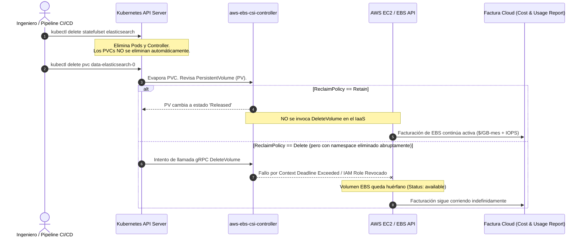
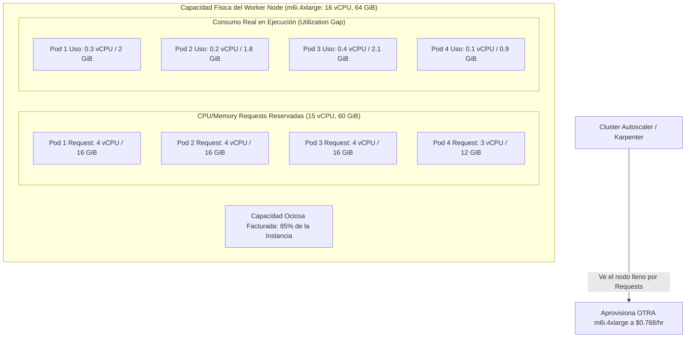

El cierre contable mensual de una plataforma de comercio distribuida arrojó una desviación de 48,000 USD en la línea de infraestructura IaaS. No hubo picos de tráfico anómalos, ataques DDoS ni campañas de marketing no planificadas. La carga de transacciones por segundo (TPS) se mantuvo dentro del percentil 95 habitual. 

Al desglosar la factura en Amazon Web Services (AWS) y Google Cloud Platform (GCP), dos partidas consumían el 38% del sobrecosto: volúmenes de almacenamiento en bloque (EBS gp3 y Persistent Disks) en estado `available` (sin asociar a ninguna instancia de cómputo) y un sobredimensionamiento crónico en los grupos de nodos de Kubernetes, donde el *allocation gap* (la brecha entre recursos solicitados y recursos consumidos) superaba el 60%.

En arquitecturas MACH y entornos cloud-native con despliegues dinámicos, la desvinculación entre el plano de control de Kubernetes y el plano de facturación del proveedor cloud crea agujeros negros financieros. Cuando un StatefulSet es eliminado o un pipeline de CI/CD destruye un entorno efímero, el comportamiento por defecto de la API de almacenamiento y los controladores CSI no siempre elimina los activos físicos subyacentes. Si a esto se suma una mala configuración del autoescalado de nodos frente al bin-packing de pods, la infraestructura acumula "fantasmas" de facturación que drenan el margen operativo de cualquier organización.

---

## La Desconexión Arquitectónica: Por Qué los Volúmenes Quedan Huérfanos

El ciclo de vida de un PersistentVolumeClaim (PVC) no equivale al ciclo de vida del bloque de almacenamiento físico aprovisionado por la nube. La capa de abstracción del *Container Storage Interface* (CSI) media entre el Scheduler de Kubernetes y las APIs del proveedor cloud (como Amazon EC2 o Google Compute Engine).



Tres factores generan volúmenes zombi en producción:

1. **`persistentVolumeReclaimPolicy: Retain` heredado**: Múltiples Helm charts de producción (Kafka, Elasticsearch, Redis) configuran `Retain` por defecto para proteger los datos contra eliminaciones accidentales. Cuando el namespace o el Helm release es destruido, el PVC desaparece, pero el `PersistentVolume` subyacente pasa al estado `Released` sin liberar el disco en AWS o Azure.
2. **Eliminación concurrente y condiciones de carrera en el CSI**: Cuando se destruye un cluster completo de EKS/GKE mediante herramientas de Infrastructure as Code (IaC) como Terraform o Pulumi sin vaciar antes los recursos de Kubernetes, el *destroy* del cluster apaga los nodos y el plano de control antes de que el controlador CSI pueda ejecutar las llamadas `DeleteVolume` contra la API del proveedor cloud. Los volúmenes EBS quedan en estado `available`, desasociados y facturando cada gigabyte aprovisionado.
3. **IOPS y Throughput aprovisionados en gp3/io2**: Con la llegada de `gp3`, la facturación no depende únicamente de la capacidad en GB, sino de las IOPS baseline que superen 3,000 y el throughput superior a 125 MB/s configurado en la `StorageClass`. Un disco huérfano de 500 GB con 10,000 IOPS y 500 MB/s aprovisionados genera un coste invisible de más de 120 USD mensuales por unidad sin procesar un solo byte de I/O.

---

## Auditoría Automatizada: Script Forense de Correlación K8s-Cloud

Para detectar discrepancias entre la API de Kubernetes y el inventario real de almacenamiento del proveedor, la inspección manual por consola es inviable. Se requiere correlación cruzada: reconciliar cada identificador de volumen en la API de IaaS contra los objetos `PersistentVolume` registrados activamente en el cluster.

El siguiente script en Python utiliza `boto3` y la API oficial de Kubernetes para identificar volúmenes huérfanos, calcular su costo de fuga mensual y verificar si registran actividad I/O en CloudWatch en los últimos 14 días.

```python
#!/usr/bin/env python3
"""
Orphan Volume & Allocation Gap Forensic Auditor
Correlaciona instancias EBS en AWS con PersistentVolumes de Kubernetes
y extrae métricas de I/O en CloudWatch para prevenir falsos positivos.
"""

import sys
import boto3
from datetime import datetime, timedelta, timezone
from kubernetes import client, config
from typing import Set, Dict, Any, List

def get_active_k8s_volume_ids() -> Set[str]:
    """Extrae todos los VolumeIDs referenciados en los PVs del cluster."""
    try:
        config.load_kube_config()
    except Exception:
        config.load_incluster_config()

    v1 = client.CoreV1Api()
    pv_list = v1.list_persistent_volume()
    active_volume_ids = set()

    for pv in pv_list.items:
        # Extracción para drivers CSI modernos (AWS EBS CSI Driver)
        if pv.spec.csi and pv.spec.csi.volume_handle:
            active_volume_ids.add(pv.spec.csi.volume_handle)
        # Compatibilidad con volúmenes legados awsElasticBlockStore
        elif pv.spec.aws_elastic_block_store and pv.spec.aws_elastic_block_store.volume_id:
            vol_id = pv.spec.aws_elastic_block_store.volume_id.split('/')[-1]
            active_volume_ids.add(vol_id)
            
    return active_volume_ids

def get_cloudwatch_io_sum(cw_client, volume_id: str, days: int = 7) -> float:
    """Verifica si el volumen tuvo operaciones de lectura/escritura recientes."""
    end_time = datetime.now(timezone.utc)
    start_time = end_time - timedelta(days=days)
    
    response = cw_client.get_metric_data(
        MetricDataQueries=[
            {
                'Id': 'read_ops',
                'MetricStat': {
                    'Metric': {
                        'Namespace': 'AWS/EBS',
                        'MetricName': 'VolumeReadOps',
                        'Dimensions': [{'Name': 'VolumeId', 'Value': volume_id}]
                    },
                    'Period': days * 86400,
                    'Stat': 'Sum'
                }
            },
            {
                'Id': 'write_ops',
                'MetricStat': {
                    'Metric': {
                        'Namespace': 'AWS/EBS',
                        'MetricName': 'VolumeWriteOps',
                        'Dimensions': [{'Name': 'VolumeId', 'Value': volume_id}]
                    },
                    'Period': days * 86400,
                    'Stat': 'Sum'
                }
            }
        ],
        StartTime=start_time,
        EndTime=end_time
    )
    
    total_ops = sum(sum(q.get('Values', [0])) for q in response.get('MetricDataResults', []))
    return total_ops

def calculate_monthly_waste_usd(volume: Dict[str, Any]) -> float:
    """Estima costo mensual de EBS gp3/gp2 en us-east-1."""
    vol_type = volume.get('VolumeType', 'gp3')
    size_gb = volume.get('Size', 0)
    monthly_cost = 0.0

    if vol_type == 'gp3':
        monthly_cost += size_gb * 0.08  # $0.08 por GB-mes
        iops = volume.get('Iops', 3000)
        throughput = volume.get('Throughput', 125)
        if iops > 3000:
            monthly_cost += (iops - 3000) * 0.005
        if throughput > 125:
            monthly_cost += (throughput - 125) * 0.04
    elif vol_type == 'gp2':
        monthly_cost += size_gb * 0.10
    elif vol_type in ['io1', 'io2']:
        monthly_cost += size_gb * 0.125
        monthly_cost += volume.get('Iops', 0) * 0.065

    return monthly_cost

def run_ebs_forensic_audit(region: str) -> List[Dict[str, Any]]:
    ec2 = boto3.client('ec2', region_name=region)
    cw = boto3.client('cloudwatch', region_name=region)
    
    print(f"[*] Obteniendo PersistentVolumes desde el plano de control K8s...")
    k8s_volumes = get_active_k8s_volume_ids()
    print(f"[+] Total PVs activos registrados en K8s: {len(k8s_volumes)}")

    print(f"[*] Obteniendo volúmenes EBS 'available' (no montados) en AWS {region}...")
    paginator = ec2.get_paginator('describe_volumes')
    page_iterator = paginator.paginate(
        Filters=[{'Name': 'status', 'Values': ['available']}]
    )

    orphaned_volumes = []
    total_monthly_waste = 0.0

    for page in page_iterator:
        for vol in page['Volumes']:
            vol_id = vol['VolumeId']
            # Si el volumen no está mapeado en K8s ni montado en EC2
            if vol_id not in k8s_volumes:
                io_activity = get_cloudwatch_io_sum(cw, vol_id, days=7)
                cost = calculate_monthly_waste_usd(vol)
                total_monthly_waste += cost
                
                orphaned_volumes.append({
                    'VolumeId': vol_id,
                    'SizeGB': vol['Size'],
                    'Type': vol['VolumeType'],
                    'Created': vol['CreateTime'].isoformat(),
                    'SevenDayIO': io_activity,
                    'MonthlyCostUSD': round(cost, 2),
                    'Tags': vol.get('Tags', [])
                })

    print(f"\n[!] HALLAZGOS FORENSES - REGIÓN: {region}")
    print(f"============================================================")
    print(f"Volúmenes huérfanos detectados: {len(orphaned_volumes)}")
    print(f"Desperdicio financiero proyectado: ${round(total_monthly_waste, 2)} USD/mes\n")

    for o in orphaned_volumes:
        print(f"ID: {o['VolumeId']} | Tipo: {o['Type']} | Tamaño: {o['SizeGB']} GB | "
              f"I/O (7d): {o['SevenDayIO']} ops | Desperdicio: ${o['MonthlyCostUSD']} USD/mes")

    return orphaned_volumes

if __name__ == "__main__":
    aws_region = sys.argv[1] if len(sys.argv) > 1 else "us-east-1"
    run_ebs_forensic_audit(aws_region)
```

---

## Sobredimensionamiento de Nodos: El Impuesto Silencioso del Allocation Gap

Mientras los discos huérfanos representan un desperdicio estático, el sobredimensionamiento de instancias en Kubernetes constituye una hemorragia dinámica continua. 

El planificador de Kubernetes (`kube-scheduler`) toma decisiones de asignación basadas exclusivamente en los `requests` declarados en las especificaciones de los pods, no en el uso real de CPU o memoria en tiempo de ejecución. Si un pod solicita 4 vCPU y 16 GiB de RAM para cubrir un hipotético pico durante una venta flash, pero en promedio consume 0.2 vCPU y 1.5 GiB de memoria, el nodo físico agotará su capacidad asignable (*allocatable capacity*) de inmediato.



El autoscaler tradicional (`cluster-autoscaler`) observa que la suma de `requests` no cabe en los nodos existentes y le ordena al Cloud Provider encender más instancias EC2 o Compute Engine. El resultado es un cluster con decenas de servidores operando al 8% de CPU real, mientras la factura mensual refleja un gasto de cómputo inflado por factores de 3x a 5x.

### Detección del Desperdicio con PromQL

Para cuantificar el *Allocation Gap* en un cluster, Prometheus nos permite contrastar la memoria reservada contra la memoria físicamente consumida (*Working Set*):

```promql
# Brecha de asignación de Memoria por Nodo en GiB
(
  sum by (node) (kube_pod_container_resource_requests{resource="memory"})
  - 
  sum by (node) (container_memory_working_set_bytes{container!=""})
) / 1024 / 1024 / 1024
```

```promql
# Porcentaje de CPU Desperdiciada por Nodo (Asignada pero no utilizada)
(
  sum by (node) (kube_pod_container_resource_requests{resource="cpu"})
  - 
  sum by (node) (rate(container_cpu_usage_seconds_total{container!=""}[5m]))
) 
/ 
sum by (node) (kube_node_status_allocatable{resource="cpu"}) * 100
```

Si el resultado de esta última métrica supera consistentemente el 40% en periodos de estabilidad, el clúster sufre de **inflación ficticia de capacidad**.

---

## Estrategias de Remediación y Purga: Trade-offs Arquitectónicos

La mitigación del desperdicio no puede comprometer la disponibilidad del plano productivo ni la integridad transaccional de los datos. A continuación, se contrastan las alternativas operativas:

| Estrategia | Ventajas | Desventajas / Trade-offs | Caso de Uso Ideal | Cuándo Evitar |
| :--- | :--- | :--- | :--- | :--- |
| **Scripts Forenses Programados (CronJobs/Lambda)** | Control granular, cero impacto en clusters activos, auditoría previa a la purga. | No previene la fuga en origen; latencia entre la creación del residuo y su detección. | Etapas iniciales de FinOps; auditorías periódicas multi-cuenta. | Entornos con rotación agresiva de cientos de pods por hora. |
| **Karpenter v1 Consolidation & Disruption** | Empaqueta dinámicamente pods (*bin-packing* agresivo), migra workloads a instancias Spot o de menor tamaño automáticamente. | Desalojo constante de pods (*pod disruption*); riesgo si las aplicaciones tardan en iniciar o carecen de PDBs (`PodDisruptionBudgets`). | Cargas de trabajo stateless, microservicios MACH, backends desacoplados. | Bases de datos distribuidas con tiempos de replicación altos o pods no tolerantes a reinicios. |
| **Kyverno / OPA Gatekeeper Policies** | Bloquea la creación de PVCs con `StorageClasses` desalineadas; impone ratios máximos entre `request` y `limit`. | Genera fricción en los equipos de desarrollo; despliegues fallidos si no se cumplen los límites estrictos. | Clusters multi-tenant con equipos descentralizados. | Proyectos piloto o pipelines de migración rápida con arquitecturas legacy. |
| **Kubecost / OpenCost Allocator** | Visibilidad en tiempo real por namespace, pod y tenant; correlación directa con la factura cloud real. | Requiere infraestructura dedicada (Prometheus a largo plazo); no ejecuta la purga de manera autónoma. | Modelos de *showback* y *chargeback* empresarial; auditoría contable. | Si se busca una solución puramente correctiva sin intervención humana. |

---

## Modos de Fallo y Barreras de Contención (Blast Radius Mitigation)

La automatización de la purga de recursos huérfanos conlleva riesgos operativos severos. Un error en la lógica de eliminación puede liquidar discos de réplicas pasivas de bases de datos o volúmenes temporales de procesos batch de larga duración que se encontraban transitoriamente desconectados.

### 1. Falso Positivo por Rebalanceo de Nodos (CSI Detach Latency)
Cuando Karpenter o el Cluster Autoscaler desaloja un nodo, el proceso de *VolumeDetach* en la nube puede tardar entre 30 y 90 segundos. Un script de limpieza que se ejecute en ese microsegundo puede ver el volumen en estado `available` y proceder a borrarlo.
*   **Mitigación**: Exigir una ventana de gracia temporal obligatoria. Ningún volumen debe purgarse a menos que su estado `available` tenga una antigüedad mínima superior a 72 horas (`CreateTime` y última modificación de metadatos).

### 2. Eliminación de Discos para Disaster Recovery Warm Standby
Ciertas arquitecturas almacenan discos EBS replicados asíncronamente en una región secundaria, los cuales no están vinculados a ningún PV activo en el cluster de contingencia hasta que ocurre un failover.
*   **Mitigación**: Implementar exclusión estricta por Tags de gobernanza. El motor de auditoría debe ignorar cualquier recurso con la etiqueta:
    ```yaml
    FinOps:Exempt: "true"
    DisasterRecovery:Target: "standby"
    ```

### 3. Configuración de AWS Recycle Bin (Papelera de Reciclaje para EBS)
Para erradicar el riesgo de pérdida irreversible de datos durante la purga forense, es mandatorio configurar una regla de **AWS Recycle Bin** a nivel de cuenta para snapshots y volúmenes EBS:

```bash
aws rbe create-rule \
    --retention-period RetentionPeriodValue=14,RetentionPeriodUnit=DAYS \
    --description "FinOps-Safety-Net-Orphan-Purge" \
    --resource-type EBS_VOLUME \
    --resource-tags ResourceTagKey=FinOpsAutoPurged,ResourceTagValue=true
```

Antes de ejecutar un `DeleteVolume`, el script o pipeline debe etiquetar el recurso con `FinOpsAutoPurged=true`. Si un operador técnico identifica que el disco contenía información crítica desvinculada por error, el volumen puede restaurarse íntegramente dentro de la ventana de 14 días.

---

## Corrección Estructural en Kubernetes: Políticas de StorageClass

Para que la fuga no se reproduzca, la infraestructura debe cerrarse desde la configuración de los objetos de almacenamiento base. Cada `StorageClass` aprovisionada debe gobernar estrictamente la política de reciclaje:

```yaml
apiVersion: storage.k8s.io/v1
kind: StorageClass
metadata:
  name: ebs-gp3-sc
  annotations:
    storageclass.kubernetes.io/is-default-class: "true"
provisioner: ebs.csi.aws.com
volumeBindingMode: WaitForFirstConsumer
reclaimPolicy: Delete
allowVolumeExpansion: true
parameters:
  type: gp3
  iops: "3000"
  throughput: "125"
  encrypted: "true"
```

La directiva `volumeBindingMode: WaitForFirstConsumer` evita el aprovisionamiento anticipado del disco hasta que el pod que lo reclama sea efectivamente asignado a un nodo. Esto impide que se creen volúmenes en zonas de disponibilidad (AZ) incorrectas que luego deban abandonarse y reconstruirse, dejando atrás fragmentos huérfanos.

---

## Runbook de Operación: Protocolo de Higiene FinOps para Día 2

Para los equipos de ingeniería de plataforma que operan infraestructuras basadas en Kubernetes, la auditoría forense debe institucionalizarse a través del siguiente checklist técnico:

- [ ] **Auditoría de ReclaimPolicy**: Ejecutar `kubectl get pv -o jsonpath='{range .items[*]}{.metadata.name}{"\t"}{.spec.persistentVolumeReclaimPolicy}{"\n"}{end}'` e identificar persistent volumes en estado `Retain` que carezcan de justificación de negocio documental.
- [ ] **Depuración de StorageClasses obsoletas**: Verificar que ninguna `StorageClass` activa utilice aprovisionadores heredados en árbol (`kubernetes.io/aws-ebs` o `kubernetes.io/gce-pd`) y que todas hayan migrado formalmente a sus drivers CSI respectivos con soporte de expansión dinámica.
- [ ] **Configuración de Drift y Disruption en Karpenter**: Si se utiliza Karpenter, verificar que los `NodePools` implementen políticas de consolidación activas (`consolidationPolicy: WhenEmptyOrUnderutilized`), permitiendo al cluster reducir nodos desaprovechados sin esperar intervenciones manuales:
  ```yaml
  spec:
    disruption:
      consolidationPolicy: WhenEmptyOrUnderutilized
      consolidateAfter: 2m
  ```
- [ ] **Revisión de Vertical Pod Autoscaler (VPA)**: Desplegar el VPA en modo `Off` (solo recomendaciones) en namespaces con alta variabilidad de consumo para extraer los percentiles 99 de uso real frente a los requests teóricos fijados por los desarrolladores.
- [ ] **Integración en CI/CD**: Implementar una etapa de validación en los pipelines de Terraform/ArgoCD que impida fusionar Pull Requests donde la relación entre `limits` y `requests` de CPU/RAM supere una proporción de 3:1, forzando un dimensionamiento predecible.
- [ ] **Pipeline de Reciclaje Automatizado**: Programar el script forense para que se ejecute quincenalmente en modo auditoría (solo lectura con reporte a canal de ingeniería) y, tras validación, en modo de marcado con advertencia de 7 días antes de la purga hacia la papelera de reciclaje cloud.