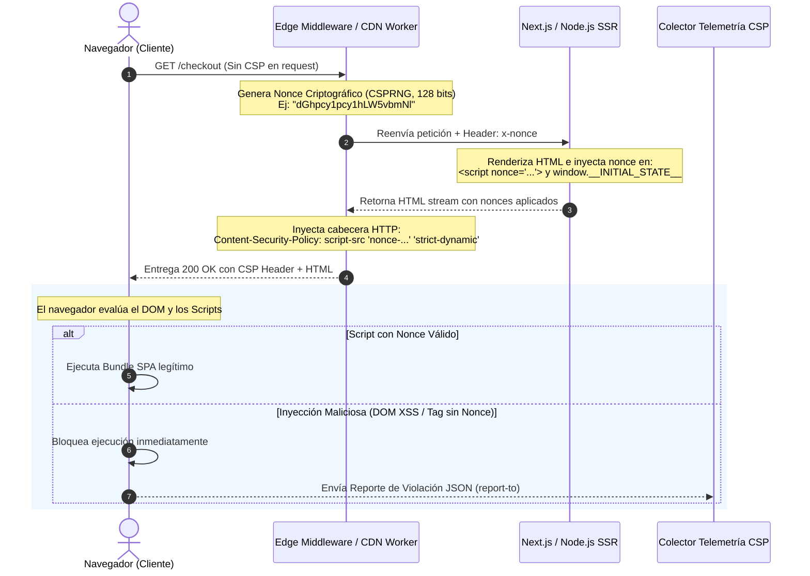

Durante una campaña de ventas de alto tráfico, un frontend headless de comercio electrónico empresarial comenzó a registrar comportamientos anómalos: credenciales de sesión y números de tarjetas ofuscados estaban siendo interceptados silenciosamente antes de alcanzar la pasarela de pagos. El vector no fue una brecha en la capa de microservicios ni una inyección SQL en la base de datos distribuida, sino la alteración de un paquete NPM de analítica de terceros alojado en un CDN público. La aplicación dependía de una política de Content Security Policy (CSP) permisiva construida bajo el modelo tradicional de listas blancas de dominios (`script-src 'self' https://*.google-analytics.com https://*.cdn.com 'unsafe-inline'`). Bastó que el atacante encontrara un script vulnerable con soporte JSONP dentro de uno de los 42 dominios autorizados para eludir por completo el CSP y ejecutar un ataque Cross-Site Scripting (XSS) persistente en el contexto de ejecución del cliente.

En arquitecturas MACH, desacoplar el frontend mediante Single Page Applications (SPAs) y Server-Side Rendering (SSR) expande drásticamente la superficie de ataque en el cliente. La dependencia de múltiples SDKs (motores de búsqueda algorítmica, pasarelas de pago, Customer Data Platforms y gestores de consentimiento) convierte al navegador en un entorno de ejecución hostil. 

Las listas blancas de dominios en CSP están obsoletas y son trivialmente vulnerables. Proteger una SPA moderna exige una transición arquitectónica hacia un **CSP Estricto basado en Nonces Criptográficos Dinámicos**, habilitado por `strict-dynamic` y complementado por la especificación del W3C **Trusted Types** para erradicar las inyecciones directas en el DOM.

---

## El Colapso de las Listas Blancas y la Anatomía de CSP Level 3

El enfoque histórico de CSP consistía en enumerar hosts confiables:

```http
# ANTI-PATRÓN: Lista blanca de dominios vulnerable
Content-Security-Policy: default-src 'self'; script-src 'self' https://cdnjs.cloudflare.com https://apis.google.com 'unsafe-inline';
```

Esta directiva sufre dos fallos estructurales irreparables:

1. **Bypass por Endpoints Abiertos (JSONP / Open Redirects):** Si un atacante inyecta un tag `<script src="https://cdnjs.cloudflare.com/.../angular.js">`, puede utilizar versiones antiguas de bibliotecas presentes en ese CDN para ejecutar expresiones arbitrarias en el contexto de la aplicación, puenteando la política sin violar la lista de orígenes.
2. **El Compromiso de `'unsafe-inline'`:** La mayoría de frameworks SPA e inyectores de hidratación SSR (Next.js, Remix, Nuxt) requieren inyectar scripts en línea para inicializar el estado (`window.__INITIAL_STATE__`). Al habilitar `'unsafe-inline'`, cualquier vector de inyección de código derivado de un DOM XSS obtiene vía libre de ejecución inmediata.

### El Modelo Strict CSP con Nonces y `strict-dynamic`

CSP Level 3 resuelve este problema desplazando la confianza del *origen del archivo* a la *prueba criptográfica de procedencia*. La directiva fundamental se estructura así:

```http
Content-Security-Policy:
  base-uri 'none';
  object-src 'none';
  script-src 'nonce-R4nd0mStr1ng' 'strict-dynamic' 'unsafe-inline' https: http:;
  require-trusted-types-for 'script';
  report-to csp-endpoint;
```

El funcionamiento de este conjunto de directivas se rige por reglas estrictas de retrocompatibilidad y elevación de seguridad:

* **`'nonce-R4nd0mStr1ng'`**: Una cadena pseudoaleatoria criptográficamente segura (mínimo 128 bits de entropía en Base64), generada de forma única por cada petición HTTP. Solo los scripts que porten el atributo `nonce="R4nd0mStr1ng"` podrán ser ejecutados por el motor de JavaScript.
* **`'strict-dynamic'`**: Instruye al navegador para que cualquier script que haya sido cargado legítimamente mediante un nonce válido tenga autorización implícita para cargar nuevos scripts dependientes vía `document.createElement('script')`. Esto elimina la necesidad de autorizar dominios dinámicos de terceros requeridos por SDKs complejos.
* **`'unsafe-inline' https: http:`**: Son ignorados por navegadores modernos cuando `nonce` y `'strict-dynamic'` están presentes en la cabecera. Su inclusión responde exclusivamente a mantener compatibilidad degradada (*fallback*) con clientes heredados (como navegadores basados en WebKit antiguos).
* **`base-uri 'none'`**: Previene ataques de manipulación de resolución de rutas relativas mediante la inyección de etiquetas `<base href="...">`.
* **`object-src 'none'`**: Bloquea la instanciación de plugins heredados altamente vulnerables mediante `<object>`, `<embed>` o `<applet>`.

---

## Flujo de Ejecución: Generación en Edge y Validación en el DOM

El despliegue de nonces dinámicos en una arquitectura desacoplada introduce un dilema de infraestructura: **¿Cómo aplicar un nonce único por petición en páginas HTML cacheadas en un CDN Edge?**

Si la página estática se almacena en caché con un nonce pre-renderizado, dicho nonce deja de ser secreto y único, invalidando el modelo de seguridad. La solución enterprise consiste en generar el nonce y mutar las cabeceras directamente en los Edge Workers / Edge Middlewares, evitando el cacheo del HTML completo o utilizando streaming con inyección dinámica del token.



---

## Implementación Técnica del Borde al Framework

A continuación, implementamos una solución desacoplada utilizando Next.js App Router coordinado con un middleware de borde (Edge Runtime).

### 1. Generación de Nonce y Mutación de Cabeceras en Middleware

Este middleware intercepta cada request entrante, genera un vector criptográfico con la API `crypto.randomUUID()`, formula la directiva CSP estricta y sincroniza el contexto con las cabeceras internas de la aplicación.

```typescript
// middleware.ts
import { NextRequest, NextResponse } from 'next/server';

export function middleware(request: NextRequest) {
  // 1. Generar 16 bytes de entropía aleatoria codificados en Base64
  const nonceBuffer = new Uint8Array(16);
  crypto.getRandomValues(nonceBuffer);
  const nonce = btoa(String.fromCharCode(...nonceBuffer));

  // 2. Construir la política estricta
  // Nota: require-trusted-types-for solo se activa si los vendors soportan la API
  const cspHeader = `
    default-src 'self';
    script-src 'nonce-${nonce}' 'strict-dynamic' 'unsafe-inline' https:;
    style-src 'self' 'nonce-${nonce}' https://fonts.googleapis.com;
    font-src 'self' https://fonts.gstatic.com data:;
    img-src 'self' data: https://images.ctfassets.net;
    connect-src 'self' https://api.commercelayer.io https://telemetry.enterprise.io;
    object-src 'none';
    base-uri 'none';
    form-action 'self';
    frame-ancestors 'none';
    require-trusted-types-for 'script';
    trusted-types default react-policy;
    report-to csp-endpoint;
  `.replace(/\s{2,}/g, ' ').trim();

  // 3. Pasar el nonce internamente hacia el Server Component
  const requestHeaders = new Headers(request.headers);
  requestHeaders.set('x-nonce', nonce);
  requestHeaders.set('Content-Security-Policy', cspHeader);

  // 4. Propagar la cabecera tanto a la respuesta como al contexto interno
  const response = NextResponse.next({
    request: {
      headers: requestHeaders,
    },
  });

  response.headers.set('Content-Security-Policy', cspHeader);
  response.headers.set('Reporting-Endpoints', 'csp-endpoint="https://telemetry.enterprise.io/v1/csp-reports"');

  return response;
}

export const config = {
  matcher: [
    /*
     * Interceptar todas las rutas excepto archivos estáticos,
     * imágenes y llamadas internas de optimización.
     */
    {
      source: '/((?!api|_next/static|_next/image|favicon.ico).*)',
      missing: [
        { type: 'header', key: 'next-router-prefetch' },
        { type: 'header', key: 'purpose', value: 'prefetch' },
      ],
    },
  ],
};
```

### 2. Consumo del Nonce en el Root Layout (SSR)

El nonce generado en el Edge debe inyectarse en el árbol de componentes del servidor para asegurar que los scripts de hidratación del framework contengan el atributo requerido.


```typescript
// app/layout.tsx
import { headers } from 'next/headers';
import Script from 'next/script';

export default async function RootLayout({
  children,
}: {
  children: React.ReactNode;
}) {
  const headersList = await headers();
  const nonce = headersList.get('x-nonce') ?? undefined;

  return (
    <html lang="es">
      <head>
        {/* Scripts externos indispensables cargados con su respectivo Nonce */}
        <Script
          src="https://js.stripe.com/v3/"
          strategy="afterInteractive"
          nonce={nonce}
        />
      </head>
      <body>
        <main>{children}</main>
        {/* Script embebido de inicialización validado por Nonce */}
        <script
          nonce={nonce}
          dangerouslySetInnerHTML={{
            __html: `window.__MACH_ENV__ = Object.freeze({ region: "us-east-1" });`,
          }}
        />
      </body>
    </html>
  );
}
```


---

## Mitigación de DOM XSS Mediante W3C Trusted Types

CSP con nonces neutraliza eficazmente la inyección de tags `<script>` en el HTML estático o dinámico entregado por el servidor. Sin embargo, **no protege contra DOM-based XSS**, donde código JavaScript ya autorizado en el cliente procesa entradas no confiables y las envía a APIs peligrosas del navegador (conocidas como *sinks* de ejecución).

Los sumideros (*sinks*) más comunes son:
* `Element.innerHTML`
* `Element.outerHTML`
* `document.write()`
* `window.location.href` (cuando recibe un pseudoprotocolo `javascript:`)
* `eval()` y los constructores de `Function`

Para mitigar esta vulnerabilidad arquitectónica en tiempo de diseño, se emplea **Trusted Types**. Al declarar `require-trusted-types-for 'script'`, el motor del navegador bloquea cualquier asignación de strings planos (`string`) a un sumidero. Toda asignación debe realizarse mediante un objeto inmutable de tipo `TrustedHTML`, `TrustedScript` o `TrustedScriptURL`, originado por una política de sanitización explícita.

```typescript
// src/security/trusted-types.ts
import DOMPurify from 'isomorphic-dompurify';

// Declaración de tipos para entornos donde la API está en etapa de adopción
declare global {
  interface Window {
    trustedTypes?: {
      createPolicy: (
        name: string,
        rules: {
          createHTML?: (input: string) => string;
          createScript?: (input: string) => string;
          createScriptURL?: (input: string) => string;
        }
      ) => TrustedTypePolicy;
      isHTML: (value: any) => value is TrustedHTML;
    };
  }
}

interface TrustedTypePolicy {
  createHTML: (input: string) => any;
  createScript: (input: string) => any;
  createScriptURL: (input: string) => any;
}

// Inicialización de la política de sanitización controlada
export const securityPolicy = (() => {
  if (typeof window !== 'undefined' && window.trustedTypes) {
    try {
      return window.trustedTypes.createPolicy('react-policy', {
        createHTML: (rawHtml: string) => {
          // Sanitización estricta mediante DOMPurify
          return DOMPurify.sanitize(rawHtml, {
            RETURN_TRUSTED_TYPE: false,
            ALLOWED_TAGS: ['b', 'i', 'em', 'strong', 'a', 'p', 'span'],
            ALLOWED_ATTR: ['href', 'target', 'rel'],
          });
        },
        createScriptURL: (rawUrl: string) => {
          const parsed = new URL(rawUrl, window.location.origin);
          // Lista estricta de dominios permitidos para instanciación de Workers o Scripts
          const trustedDomains = ['apis.google.com', 'js.stripe.com'];
          
          if (parsed.origin === window.location.origin || trustedDomains.includes(parsed.hostname)) {
            return parsed.toString();
          }
          throw new SecurityError(`[TrustedTypes] Dominio de script no autorizado: ${parsed.hostname}`);
        },
      });
    } catch (e) {
      console.warn('Trusted Types Policy ya registrada o bloqueada por la configuración.');
    }
  }
  return null;
})();

export function getSafeHTML(untrustedHtml: string): any {
  if (securityPolicy) {
    return securityPolicy.createHTML(untrustedHtml);
  }
  // Fallback para motores que no soportan W3C Trusted Types
  return DOMPurify.sanitize(untrustedHtml);
}
```

Al utilizar este patrón en un componente de renderizado de CMS (por ejemplo, descripciones de producto provenientes de Contentful o Sanity):


```tsx
// src/components/RichTextRenderer.tsx
'use client';

import React from 'react';
import { getSafeHTML } from '@/security/trusted-types';

interface Props {
  rawCmsHtml: string;
}

export const RichTextRenderer: React.FC<Props> = ({ rawCmsHtml }) => {
  // Si require-trusted-types-for 'script' está activo y pasamos un string crudo,
  // el navegador arrojará un TypeError en tiempo de ejecución de forma nativa.
  const safeContent = getSafeHTML(rawCmsHtml);

  return (
    <div
      className="prose-content"
      dangerouslySetInnerHTML={{ __html: safeContent }}
    />
  );
};
```


---

## Comparativa de Trade-Offs Arquitectónicos

La implementación de mecanismos de protección client-side exige balancear seguridad, compatibilidad y costos de infraestructura.

| Mecanismo de Seguridad | Complejidad de Implementación | Impacto en TTFB / Caché | Resiliencia XSS | Falsos Positivos Comunes |
| :--- | :--- | :--- | :--- | :--- |
| **CSP con Listas Blancas de Dominios** | Baja | Nulo (Páginas 100% estáticas en CDN) | **Nula / Inefectiva** (Bypasses masivos vía JSONP/CDNs) | Ninguno |
| **Strict CSP con Hashes (`sha256-...`)** | Media | Nulo (Compatible con Full Static Caching) | **Alta** (Solo scripts con código estático inalterable) | Cada actualización del bundle en CI/CD rompe la política |
| **Strict CSP con Nonces + `strict-dynamic`** | Alta | Medio (Requiere Edge Compute para mutar cabeceras) | **Máxima** (Protección completa ante inyecciones HTML) | Hydration mismatches si el SSR y el Edge divergen |
| **W3C Trusted Types Enforced** | Muy Alta | Nulo a nivel de red (Sobrecarga de CPU client-side mínima) | **Absoluta contra DOM XSS** (Bloquea sumideros a nivel de runtime) | Librerías heredadas de terceros que usan `innerHTML` sin soporte |

---

## Modos de Fallo en Producción y Mitigación Operativa

Implementar un CSP estricto en producción no es un evento de un solo despliegue; introduce puntos de fallo específicos que deben gestionarse en las Operaciones de Día 2.

### 1. El Conflicto de la Caché CDN: Nonces Duplicados o Invalidados

* **El Fallo:** Si un CDN almacena en caché la respuesta HTML completa generada por SSR, el valor del nonce queda congelado para todos los usuarios subsiguientes. Cuando un usuario recibe una página con un nonce cacheado que ya expiró o que no coincide con las políticas dinámicas emitidas por la capa de borde, la consola del navegador bloqueará la totalidad del bundle JavaScript del framework, provocando una pantalla blanca (*White Screen of Death*).
* **La Mitigación:** La página HTML nunca debe cachearse en el Edge como un archivo monolítico si contiene nonces. Existen dos caminos de diseño:
  1. Configurar `Cache-Control: private, no-cache, no-store, must-revalidate` en los endpoints HTML, permitiendo que el Edge compute ejecute la renderización SSR por cada solicitud.
  2. Implementar **Edge-Side Includes (ESI)** o Edge Workers con streaming (usando APIs como `HTMLRewriter` en Cloudflare Workers). El CDN cachea el cuerpo HTML base con un marcador de posición (ej: `__NONCE_INJECTION_POINT__`), y el Worker del CDN reemplaza el marcador e inyecta la cabecera CSP calculada en tiempo de tránsito a sub-milisegundo.

### 2. Bloqueo Silencioso de Google Tag Manager (GTM) y MarTech Tags

* **El Fallo:** GTM opera inyectando fragmentos arbitrarios de código en tiempo de ejecución. Aunque `'strict-dynamic'` permite que el script principal de GTM cargue scripts secundarios, muchas etiquetas analíticas mal diseñadas insertan scripts *inline* dinámicos sin el nonce correspondiente utilizando APIs como `document.write()`.
* **La Mitigación:**
  * Configurar GTM para soportar CSP. En las opciones avanzadas de contenedores de Tag Manager, debe mapearse la variable del nonce para que sea leída de `window.__CSP_NONCE__` o del DOM.
  * Durante las primeras fases de migración, **nunca** active la directiva de forma restrictiva (`Content-Security-Policy`). Despliegue inicialmente utilizando la cabecera `Content-Security-Policy-Report-Only`.
  * Procese las métricas de violación en un recolector dedicado. No aplique la directiva bloqueante hasta que la tasa de violaciones genuinas de proveedores autorizados sea exactamente 0%.

### 3. Ataques de DoS hacia el Endpoint de Telemetría (`Report-To`)

* **El Fallo:** Un atacante deliberadamente genera miles de violaciones de CSP inyectando código en sus propios clientes locales o mediante navegadores headless distribuidos, saturando el endpoint de ingesta de telemetría y generando sobrecostos de observabilidad.
* **La Mitigación:**
  * Desacoplar la ingesta de reportes mediante un API Gateway con rate limiting granular por IP / Client Fingerprint.
  * Muestrear los reportes de violaciones en el navegador configurando la cabecera de reporte para no enviar el 100% de los incidentes si el volumen supera umbrales nominales:
  ```http
  Reporting-Endpoints: csp-endpoint="https://telemetry.enterprise.io/v1/csp-reports?sample=0.05"
  ```

---

## Checklist de Implementación Arquitectónica

Antes de promover un frontend desacoplado con CSP Estricto y Trusted Types a producción, audite cada componente de la infraestructura:

- [ ] **Eliminación Total de Listas Blancas:** Confirmar que no existan directivas `script-src` dependientes de dominios comodín (ej: `*.cloudfront.net`, `*.google.com`).
- [ ] **Generación Criptográfica de Nonce:** Validar que el algoritmo de generación en el Edge utilice un CSPRNG (`crypto.getRandomValues`) con al menos 128 bits de entropía en Base64.
- [ ] **Presencia de `strict-dynamic`:** Asegurar que `strict-dynamic` acompañe al nonce para delegar la carga de librerías legítimas de terceros.
- [ ] **Restricción de Recursos Auxiliares:** Verificar que `object-src 'none'`, `base-uri 'none'` y `frame-ancestors 'none'` (o restringido a dominios de autenticación) estén presentes para evitar Clickjacking y manipulaciones de contexto.
- [ ] **Auditoría de Caché HTML:** Garantizar que los balanceadores de carga y capas de CDN no estén almacenando en caché páginas SSR con nonces embebidos en el payload.
- [ ] **Despliegue Progresivo en Modo Report-Only:** Mantener `Content-Security-Policy-Report-Only` activo durante al menos 14 días en entornos de Staging y Producción, monitorizando eventos atípicos en sistemas APM (Datadog, Elastic o Sentry).
- [ ] **Habilitación de Trusted Types:** Implementar políticas de Trusted Types para todas las manipulaciones del DOM mediante wrappers sanitizados con `DOMPurify`, erradicando por completo el uso directo de `dangerouslySetInnerHTML` con strings no controlados.