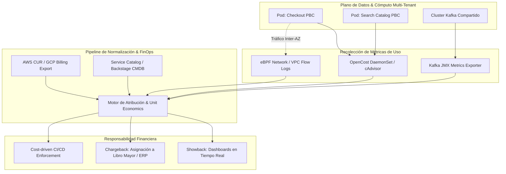

El cierre fiscal de Q3 arroja una factura de infraestructura en la nube de 485.000 USD mensuales, un incremento interanual del 68% que supera con creces el crecimiento del 22% en el volumen transaccional de la plataforma. La respuesta estándar del equipo de infraestructura ante el CFO suele ser la misma: *“El clúster principal de EKS y la red troncal absorbieron el pico de tráfico; no podemos determinar con precisión qué porcentaje de los 95.000 USD de transferencia inter-AZ o de las instancias spot no asignadas corresponde al Checkout, al motor de Búsqueda o al pipeline de analítica”*.

Este escenario es la consecuencia directa de tratar la infraestructura como un pozo común (*tragedy of the commons*). En arquitecturas distribuidas y modelos MACH, desacoplar el ciclo de despliegue del software sin desacoplar la responsabilidad financiera genera incentivos perversos: los equipos de producto sobredimensionan CPU y memoria mediante Requests excesivos en Kubernetes para eludir llamadas de guardia nocturnas, mientras que FinOps intenta mitigar el impacto adquiriendo *Savings Plans* a ciegas sobre recursos ociosos.

Romper este ciclo exige abandonar la contabilidad agregada e implementar un pipeline determinista de atribución granular de costos, transitando de un modelo pasivo de visualización (*Showback*) a una imputación contable directa contra los presupuestos operativos de los dominios de producto (*Chargeback*).

---

## El Desafío Arquitectónico: Desglosando la Infraestructura Compartida

En plataformas *composable*, la mayor fricción técnica no radica en etiquetar una base de datos Aurora dedicada o un bucket de S3 asignado a un servicio específico. La verdadera complejidad reside en los **recursos compartidos de plataforma**:

1. **Cómputo Multi-tenant (Kubernetes):** Decenas de microservicios comparten nodos de cómputo donde el costo real de un nodo EC2 o Compute Engine debe prorratearse dinámicamente según solicitudes (*Requests*), uso real (*Usage*) y la capacidad ociosa (*Slack/Idle capacity*).
2. **Backbones de Eventos (Apache Kafka / AWS MSK):** Múltiples dominios publican y consumen mensajes sobre los mismos *brokers*, compartiendo IOPS de disco, CPU y transferencia de red entre zonas de disponibilidad.
3. **Mallas de Servicios y Edge Gateways:** Costos de egress de Envoy, Istio o Cloudflare Workers que enrutan tráfico hacia múltiples *Packaged Business Capabilities* (PBCs).

### Modelo de Flujo de Datos para Atribución Granular

Para resolver este desacoplamiento, la plataforma debe capturar métricas a nivel de kernel/cgroup, reconciliarlas con los archivos de facturación detallada del proveedor cloud (AWS Cost and Usage Report - CUR, o GCP Cloud Billing Export) y mapearlas contra un catálogo centralizado de servicios.



---

## Atribución Matemática de Cómputo Multi-Tenant

El error más común en Kubernetes es calcular el costo asignado únicamente con base en el uso real ($CPU_{usage}$). Si un contenedor solicita $4\text{ vCPU}$ pero utiliza $0.5\text{ vCPU}$, el nodo no puede programar otras cargas de trabajo en ese espacio garantizado. El costo del *desperdicio* debe transferirse al equipo que configuró la reserva.

La fórmula de atribución de cómputo para un contenedor $i$ en un nodo $N$ con costo por hora $Cost_N$ se define como:

$$Cost_i = Cost_N \times \left( \alpha \frac{\max(CPU^{req}_i, CPU^{use}_i)}{\sum_j \max(CPU^{req}_j, CPU^{use}_j)} + (1 - \alpha) \frac{\max(RAM^{req}_i, RAM^{use}_i)}{\sum_j \max(RAM^{req}_j, RAM^{use}_j)} \right)$$

Donde $\alpha$ y $(1 - \alpha)$ representan la ponderación de costo relativo entre CPU y Memoria del tipo de instancia subyacente según el proveedor de nube. 

La **capacidad ociosa no asignable** del nodo (*idle capacity restante*) se amortiza proporcionalmente entre todos los inquilinos del clúster o se traslada a la cuenta de costo del equipo de Plataforma (habilitando visibilidad directa del factor de eficiencia de empaquetado del clúster).

---

## Implementación Técnica: Pipeline de Ingesta y Reconciliación

Para materializar este cálculo en producción, integramos la API de OpenCost con los registros de uso de Kafka y los metadatos organizacionales de un Service Catalog (Backstage). El siguiente script en Python procesa y normaliza los costos de cómputo y mensajería compartida, generando los registros contables listos para el ERP corporativo.

```python
#!/usr/bin/env python3
"""
finops_cost_allocator.py
Procesa métricas de OpenCost y métricas de red de Apache Kafka, 
ponderando capacidad ociosa y asignando costos a Centros de Costos corporativos.
"""

import os
import requests
import json
from typing import Dict, Any, List
from decimal import Decimal, ROUND_HALF_UP

OPENCOST_API_URL = os.getenv("OPENCOST_API_URL", "http://opencost.monitoring.svc:9003/allocation/compute")
KAFKA_METRICS_API = os.getenv("KAFKA_METRICS_API", "http://prometheus.monitoring.svc:9090/api/v1/query")

# Mapeo de namespaces / etiquetas a Centros de Costo (Cost Centers)
TEAM_COST_CENTERS = {
    "checkout-domain": "CC-4011-TRANSACTIONS",
    "search-catalog": "CC-4022-DISCOVERY",
    "customer-identity": "CC-4033-IAM",
    "platform-shared": "CC-9000-SHARED-INFRA"
}

def fetch_opencost_allocations(window: str = "7d") -> Dict[str, Any]:
    """Obtiene la asignación de costos de cómputo y memoria desglosada por namespace."""
    params = {
        "window": window,
        "aggregate": "namespace",
        "accumulate": "true",
        "idle": "true"
    }
    response = requests.get(OPENCOST_API_URL, params=params, timeout=30)
    response.raise_for_status()
    return response.json()["data"][0]

def fetch_kafka_bandwidth_bytes(window_seconds: int = 604800) -> Dict[str, float]:
    """
    Consulta Prometheus para obtener el volumen de bytes transferidos por Service ID 
    en el cluster Kafka compartido en los últimos 'window_seconds'.
    """
    query = f'sum by (client_id) (increase(kafka_server_brokertopicmetrics_bytesin_total[{window_seconds}s]))'
    response = requests.get(KAFKA_METRICS_API, params={'query': query}, timeout=30)
    response.raise_for_status()
    
    results = response.json()['data']['result']
    bandwidth_map = {}
    for entry in results:
        client = entry['metric'].get('client_id', 'unknown')
        bytes_in = float(entry['value'][1])
        bandwidth_map[client] = bytes_in
    return bandwidth_map

def calculate_chargeback_ledger(
    opencost_data: Dict[str, Any], 
    kafka_bytes: Dict[str, float], 
    kafka_total_cost: Decimal
) -> List[Dict[str, Any]]:
    """Calcula la imputación final unificando cómputo, idle prorrateado y mensajería."""
    ledger_entries = []
    
    # 1. Procesar costos de Kubernetes
    total_idle_cost = Decimal(str(opencost_data.get("__idle__", {}).get("totalCost", 0.0)))
    active_namespaces = {k: v for k, v in opencost_data.items() if not k.startswith("__")}
    
    total_active_cost = sum(Decimal(str(v.get("totalCost", 0.0))) for v in active_namespaces.values())
    
    for ns, metrics in active_namespaces.items():
        base_cost = Decimal(str(metrics.get("totalCost", 0.0)))
        cost_center = TEAM_COST_CENTERS.get(ns, TEAM_COST_CENTERS["platform-shared"])
        
        # Prorrateo de Idle basado en el peso del gasto activo
        idle_share = Decimal("0.0")
        if total_active_cost > Decimal("0.0"):
            idle_share = (base_cost / total_active_cost) * total_idle_cost
            
        allocated_compute = (base_cost + idle_share).quantize(Decimal("0.01"), rounding=ROUND_HALF_UP)
        
        ledger_entries.append({
            "cost_center": cost_center,
            "domain_namespace": ns,
            "dimension": "K8S_COMPUTE_AND_IDLE",
            "amount_usd": float(allocated_compute),
            "idle_absorbed_usd": float(idle_share.quantize(Decimal("0.01"), rounding=ROUND_HALF_UP))
        })
        
    # 2. Prorratear costo de Kafka Compartido basado en Bytes Producidos
    total_bytes = sum(kafka_bytes.values())
    if total_bytes > 0:
        for client, byte_count in kafka_bytes.items():
            cost_center = TEAM_COST_CENTERS.get(client, TEAM_COST_CENTERS["platform-shared"])
            share_ratio = Decimal(str(byte_count)) / Decimal(str(total_bytes))
            allocated_kafka = (share_ratio * kafka_total_cost).quantize(Decimal("0.01"), rounding=ROUND_HALF_UP)
            
            ledger_entries.append({
                "cost_center": cost_center,
                "domain_namespace": client,
                "dimension": "KAFKA_SHARED_BANDWIDTH",
                "amount_usd": float(allocated_kafka),
                "bytes_transferred": byte_count
            })
            
    return ledger_entries

if __name__ == "__main__":
    k8s_allocations = fetch_opencost_allocations()
    # Simulación de métricas de Kafka
    sample_kafka_bytes = {
        "checkout-domain": 524288000000.0,  # 500 GiB
        "search-catalog": 1073741824000.0,   # 1 TiB
        "customer-identity": 53687091200.0   # 50 GiB
    }
    SHARED_KAFKA_MONTHLY_COST = Decimal("3500.00")
    
    chargeback_result = calculate_chargeback_ledger(
        k8s_allocations, 
        sample_kafka_bytes, 
        SHARED_KAFKA_MONTHLY_COST
    )
    
    print(json.dumps(chargeback_result, indent=2))
```

---

## Gobernanza de Etiquetado Obligatorio mediante OPA Gatekeeper

Ningún modelo de showback funciona si la infraestructura no está correctamente etiquetada en el origen. Dejar la asignación en manos de la buena voluntad de los desarrolladores es una falla operativa garantizada. La plataforma debe impedir el despliegue de cualquier carga de trabajo que carezca de metadatos de atribución.

A continuación, la definición de un constraint de Open Policy Agent (OPA) Gatekeeper que bloquea cualquier `Deployment`, `StatefulSet` o `Job` que no incluya el centro de costos corporativo y el nivel de entorno:

```yaml
apiVersion: constraints.gatekeeper.sh/v1beta1
kind: K8sRequiredLabels
metadata:
  name: enforce-finops-core-labels
spec:
  match:
    kinds:
      - apiGroups: ["apps"]
        kinds: ["Deployment", "StatefulSet"]
      - apiGroups: ["batch"]
        kinds: ["Job"]
    namespaces:
      - "checkout-domain"
      - "search-catalog"
      - "customer-identity"
  parameters:
    labels:
      - key: "finops.mach.internal/cost-center"
        allowedRegex: "^CC-[0-9]{4}-[A-Z0-9_-]+$"
      - key: "finops.mach.internal/owner-team"
        allowedRegex: "^team-[a-z0-9-]+$"
      - key: "finops.mach.internal/environment"
        allowedRegex: "^(production|staging|development)$"
```

Si el pipeline de CI/CD intenta desplegar un manifiesto sin estas etiquetas, el API Server rechazará la llamada de admisión con código `403 Forbidden`, deteniendo la creación de recursos "huérfanos" antes de que generen facturación.

---

## Trade-offs Arquitectónicos: Estrategias de Imputación de Costos

No todas las organizaciones poseen la madurez contable o cultural para implementar Chargeback de inmediato. La siguiente tabla contrasta las alternativas arquitectónicas para operacionalizar FinOps:

| Dimensión | Showback Pasivo | Soft Chargeback (Presupuestos Virtuales) | Hard Chargeback (Débito a P&L Real) |
| :--- | :--- | :--- | :--- |
| **Mecanismo Operativo** | Reportes semanales y dashboards en Grafana/Datadog para los Product Managers. | Comparación contra un presupuesto virtual acordado; alertas si se supera la cuota. | Asientos contables automáticos hacia el Libro Mayor del ERP (SAP, NetSuite). |
| **Fricción Organizacional** | Muy baja. No hay penalización directa por ineficiencias de cómputo. | Media. Provoca discusiones sobre cuotas en comités de arquitectura/producto. | Alta. Los directores de producto disputan la atribución de infraestructura compartida. |
| **Complejidad de Plataforma** | Baja. Exportación periódica de AWS CUR y métricas de Prometheus. | Media. Requiere tracking de presupuestos y gestión de desvíos (*variance*). | Crítica. Requiere conciliación con precisión de centavos y auditoría financiera. |
| **Impacto en Reducción de Desperdicio** | Bajo (5% a 10%). Sin consecuencias económicas, las optimizaciones pierden prioridad. | Moderado (15% a 25%). Genera visibilidad ante la gerencia técnica. | Alto (30% a 50%). El equipo optimiza proactivamente para mantener su margen bruto. |
| **Cuándo Implementar** | Fase inicial de migración cloud o modernización a microservicios. | Equipos de producto consolidados con ownership de servicios en producción. | Organizaciones maduras basadas en Unit Economics y dominios autónomos. |
| **Cuándo Evitarlo** | Startups en fase de validación de tracción o hipercrecimiento acelerado. | Entornos con pipelines de entrega de software desestabilizados. | Organizaciones centralizadas donde producto no controla sus decisiones técnicas. |

---

## De Infraestructura a Unit Economics: Vinculando Costos con Métricas de Negocio

La meta final de FinOps no es gastar menos, sino **gastar con mayor rentabilidad marginal**. Reportar que el *Checkout PBC* costó 12.400 USD este mes aporta poco contexto. Sin embargo, contrastar ese costo contra los 410.000 pedidos procesados revela un costo de cómputo de **0.0302 USD por orden**.

Si en el siguiente ciclo la métrica se eleva a **0.0510 USD por orden** mientras el volumen se mantiene constante, la arquitectura ha sufrido una regresión técnica (por ejemplo, consultas N+1 en bases de datos que incrementan el I/O en RDS, o saturación de serialización en el API Gateway).

### El Triángulo de Métricas de Negocio

```
              Costo Total Cloud del Dominio (USD)
Unit Metric = -----------------------------------------
               Volumen de la Unidad de Negocio Principal
```

* **Comercio Transaccional:** $\frac{\text{Costo Total Checkout + Pagos}}{\text{Órdenes Confirmadas}}$
* **Catálogo y Búsqueda:** $\frac{\text{Costo ElasticSearch / Algolia + Pods}}{\text{1,000 Peticiones de Búsqueda}}$
* **Fidelización / Notificaciones:** $\frac{\text{Costo Workers + Colas SQS}}{\text{Eventos de Carrito Abandonado Enviados}}$

Al correlacionar el costo por transacción con los despliegues en el pipeline de entrega continua, las alertas de regresión de costos adquieren la misma severidad que una degradación en el P99 de latencia o un incremento en las tasas de error 5xx.

---

## Modos de Fallo en Producción y Mitigación

### 1. Parálisis por Sobre-Optimización (Bicicleteo Financiero)
* **El Fallo:** Equipos de ingeniería detienen el desarrollo de funcionalidades de negocio durante dos sprints completos para reescribir un servicio en Rust con el fin de ahorrar 85 USD mensuales en instancias de cómputo.
* **Mitigación:** Establecer un umbral de significancia económica (ej. iniciativas de optimización sólo se priorizan si el ahorro proyectado supera el costo de la hora/hombre del equipo en un horizonte de retorno a 3 meses).

### 2. Canibalismo en Ambientes de Preproducción
* **El Fallo:** Bajo Hard Chargeback estricto, los equipos apagan réplicas esenciales en Staging o deshabilitan métricas de observabilidad para reducir su factura, provocando que incidentes críticos de concurrencia no se detecten previo al pase a Producción.
* **Mitigación:** Subsidiar la infraestructura no productiva mediante un presupuesto centralizado operado por el equipo de Plataforma, aplicando la imputación económica directa únicamente sobre entornos productivos vinculados a generación de valor.

### 3. El Agujero Negro del Egress Inter-AZ
* **El Fallo:** El despliegue de una arquitectura distribuida con microservicios en múltiples zonas de disponibilidad (para garantizar alta disponibilidad) dispara los costos de transferencia de red cross-AZ sin que ningún equipo asuma la propiedad.
* **Mitigación:** Implementar topologías conscientes de la topología de red (*Topology Aware Routing*) en Kubernetes para priorizar el enrutamiento de tráfico dentro de la misma zona de disponibilidad, evitando saltos innecesarios por la red troncal del cloud provider.

---

## Checklist de Implementación para Arquitectos de Plataforma

Para llevar la atribución de infraestructura de la teoría a la operación diaria de ingeniería, ejecute este plan de acción técnico:

- [ ] **Gobernanza de Admisión:** Desplegar políticas con Gatekeeper o Kyverno que rechacen cualquier recurso K8s, bucket, cola o base de datos que carezca de las etiquetas obligatorias: `cost-center`, `owner-team`, `environment` y `service-name`.
- [ ] **Medición en el Kernel:** Instalar OpenCost, Kubecost o agentes de telemetría eBPF en todos los clústeres para capturar el consumo exacto de CPU, Memoria, GPU y red por Pod, Namespace y DaemonSet.
- [ ] **Exportación Automatizada de Facturación:** Habilitar el pipeline horario de ingesta del AWS CUR hacia un bucket de S3 particionado por fecha, o configurar el GCP Cloud Billing hacia BigQuery.
- [ ] **Definición de Claves de Prorrateo:** Acordar con FinOps, Arquitectura y Finanzas la fórmula para distribuir la capacidad ociosa (*Idle Capacity*) y los recursos core (mallas de servicios, gateways, Kafka, bases de datos compartidas).
- [ ] **Retroalimentación en CI/CD:** Incorporar herramientas de análisis estático de costos (como *Infracost*) en los pull requests de Terraform/OpenTofu para mostrar el impacto financiero en dólares antes de realizar un merge a la rama principal.
- [ ] **Dashboarding Transparente (Showback First):** Proveer a cada Product Manager y Tech Lead un tablero en Grafana que muestre su gasto acumulado del mes, proyección (*forecast*) y métrica de *Unit Economics* (costo por orden o transacción).
- [ ] **Transición a Chargeback Gradual:** Ejecutar tres meses consecutivos de *Showback* y *Soft Chargeback* para estabilizar la confianza en la precisión de los datos antes de ejecutar débitos vinculantes en el ERP contra los balances de los centros de costo.