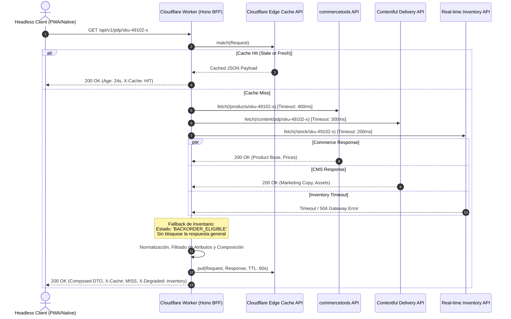

Durante un evento de tráfico masivo como el Black Friday, un *retailer* global con arquitectura Composable experimentó una degradación crítica en el P99 de su experiencia móvil: la latencia de carga de la página de detalle de producto (PDP) escaló de 320 ms a más de 2.4 segundos. La causa raíz no radicaba en los motores SaaS subyacentes (commercetools, Contentful o Algolia), sino en la capa intermedia: un clúster sobredimensionado de Node.js/Fastify ejecutándose en AWS ECS Fargate configurado como Backend for Frontend (BFF). El cuello de botella combinaba tres factores letales en producción: contención del bucle de eventos (*event loop lag*) al deserializar cargas JSON masivas en paralelo, *cold starts* impredecibles durante el autoescalado de tareas Fargate (con penalizaciones de 45 a 90 segundos) y una penalización geográfica severa cuando clientes europeos enrutaban peticiones hacia la región `us-east-1`.

El patrón arquitectónico BFF nació para desacoplar el consumo de clientes específicos de la granularidad de las APIs de dominio. Sin embargo, trasladar este patrón a contenedores tradicionales o runtimes serverless basados en Node.js sobre máquinas virtuales degrada el rendimiento de la red y encarece la infraestructura. La solución moderna para arquitecturas MACH de ultra-baja latencia consiste en migrar el BFF al borde (*edge compute*) utilizando **Hono** sobre **Cloudflare Workers**. Al ejecutarse sobre aislamiento de V8 (*V8 isolates*) en lugar de contenedores o entornos virtualizados completos, reducimos el tiempo de arranque en frío a prácticamente cero milisegundos y aproximamos la agregación de datos a menos de 15 ms de distancia del usuario final.

---

## El Problema del BFF Centralizado Frente al Fan-Out Distribuido

En un ecosistema Composable Commerce, renderizar una sola pantalla requiere orquestar múltiples capacidades de negocio empaquetadas (PBCs). Un cliente móvil no debe ejecutar seis llamadas HTTP simultáneas sobre redes celulares inestables; la agregación y el filtrado de campos deben ocurrir en el backend. 

```
[Cliente Móvil / SPA]
         │
         ▼ (1 request HTTP/3)
 ┌────────────────────────────────────────────────────────┐
 │  Cloudflare Global Anycast Network                     │
 │  ┌──────────────────────────────────────────────────┐  │
 │  │ Hono BFF en Cloudflare Worker (V8 Isolate)       │  │
 │  └──────┬──────────────┬──────────────┬─────────────┘  │
 └─────────┼──────────────┼──────────────┼────────────────┘
           │              │              │
           │ (Internal    │ (Internal    │ (Internal
           │  Fetch)      │  Fetch)      │  Fetch)
           ▼              ▼              ▼
     ┌───────────┐  ┌───────────┐  ┌───────────┐
     │ Headless  │  │ Headless  │  │ Inventory │
     │ Commerce  │  │ CMS       │  │ Engine    │
     │ Engine    │  │ (GraphQL) │  │ (REST)    │
     └───────────┘  └───────────┘  └───────────┘
```

Cuando este BFF se hospeda en un entorno centralizado (como un clúster Kubernetes en una única región de nube), introduce una doble penalización de red:

1. **Latencia de Ida y Vuelta (RTT) Agravada:** Un usuario en Tokio conecta con un contenedor en Irlanda para que este agregue datos de un CMS alojado en Fráncfort y un motor de inventario en Tokio. La distancia física arruina el presupuesto de latencia antes de procesar un solo byte.
2. **Amplificación de Fallos por Concurrencia Bloqueante:** Aunque Node.js implementa I/O no bloqueante, la agregación intensiva de múltiples respuestas HTTP mediante `Promise.all` fuerza al motor V8 a parsear grandes árboles JSON simultáneamente. En momentos de sobrecarga, la cola de tareas del microtask loop se satura, disparando la latencia en todos los endpoints concurrentes del contenedor.

### Por qué Hono sobre V8 Isolates

A diferencia de Express o NestJS, diseñados en la era de los servidores persistentes de Node.js, **Hono** fue concebido desde el primer día bajo los estándares Web Fetch API (`Request`, `Response`, `Headers`). Sus ventajas arquitectónicas en el Edge son determinantes:

* **Huella de Memoria Minúscula:** El runtime de Hono añade menos de 15 KB al bundle compilado. Un worker completo con lógica de agregación compleja suele pesar menos de 200 KB, permitiendo instanciaciones instantáneas dentro de los límites de memoria de Cloudflare Workers (128 MB estándar).
* **Enrutamiento Ultra-Rápido:** Hono implementa `RegExpRouter`, un algoritmo de enrutamiento que compila todas las rutas registradas en una única expresión regular lineal optimizada, logrando resoluciones de ruta en sub-microsegundos sin el overhead de árboles Radix dinámicos.
* **Cero Cold Starts de Contenedor:** Los Workers de Cloudflare no inician un sistema operativo invitado ni un proceso de Node.js; crean un contexto V8 Isolate en menos de 5 milisegundos, erradicando los picos de latencia durante ráfagas de tráfico repentinas.

---

## Topología de Agregación Concurrente y Resiliencia en el Edge

El siguiente diagrama de secuencia detalla cómo el BFF en Hono maneja la composición de la PDP aplicando concurrencia controlada, timeouts específicos por proveedor y degradación elegante:



---

## Implementación de Producción: Hono BFF para Composable Commerce

A continuación se presenta una implementación en TypeScript lista para producción de un endpoint de agregación PDP en Hono, incorporando tipado estricto con **Zod**, timeouts adaptativos con `AbortSignal`, propagación de correlación para observabilidad distribuida y gestión del Cloudflare Cache API nativo.

```typescript
// src/index.ts
import { Hono } from 'hono';
import { z } from 'zod';
import { zValidator } from '@hono/zod-validator';
import { cors } from 'hono/cors';
import { logger } from 'hono/logger';

// Tipado de variables de entorno inyectadas por Cloudflare Workers
type Bindings = {
  COMMERCE_API_URL: string;
  COMMERCE_API_TOKEN: string;
  CMS_API_URL: string;
  CMS_API_TOKEN: string;
  INVENTORY_API_URL: string;
  INVENTORY_API_TOKEN: string;
  ENVIRONMENT: string;
};

// Esquema de validación para parámetros de entrada
const ParamSchema = z.object({
  sku: z.string().regex(/^[A-Za-z0-9-_]{4,64}$/, 'Formato de SKU inválido'),
});

// DTO optimizado que el cliente móvil realmente necesita
interface ProductDetailDTO {
  id: string;
  sku: string;
  name: string;
  price: {
    amount: number;
    currency: string;
  };
  richDescriptionHtml: string;
  mediaUrls: string[];
  stockLevel: 'IN_STOCK' | 'LOW_STOCK' | 'OUT_OF_STOCK' | 'UNKNOWN';
  sourceTimestamps: {
    commerceLatencyMs: number;
    cmsLatencyMs: number;
    inventoryLatencyMs: number;
  };
}

const app = new Hono<{ Bindings: Bindings }>();

app.use('*', logger());
app.use('*', cors({
  origin: ['https://shop.enterprise.com', 'https://mobile-app.enterprise.com'],
  allowMethods: ['GET', 'OPTIONS'],
  maxAge: 86400,
}));

// Middleware de correlación para observabilidad distribuida
app.use('*', async (c, next) => {
  const traceId = c.req.header('x-trace-id') || crypto.randomUUID();
  c.set('traceId', traceId);
  await next();
  c.res.headers.set('x-trace-id', traceId);
});

// Función auxiliar para subpeticiones con timeout estricto
async function fetchWithTimeout(
  url: string,
  options: RequestInit,
  timeoutMs: number
): Promise<{ response: Response | null; latencyMs: number; error?: string }> {
  const controller = new AbortController();
  const timeoutId = setTimeout(() => controller.abort(), timeoutMs);
  const start = performance.now();

  try {
    const res = await fetch(url, {
      ...options,
      signal: controller.signal,
    });
    const latencyMs = Math.round(performance.now() - start);
    return { response: res, latencyMs };
  } catch (err: unknown) {
    const latencyMs = Math.round(performance.now() - start);
    const errorMessage = err instanceof Error ? err.message : 'Unknown Network Error';
    return { response: null, latencyMs, error: errorMessage };
  } finally {
    clearTimeout(timeoutId);
  }
}

app.get('/api/v1/pdp/:sku', zValidator('param', ParamSchema), async (c) => {
  const { sku } = c.req.valid('param');
  const cache = caches.default;
  const cacheKey = new Request(c.req.url, c.req.raw);

  // 1. Verificación en el Edge Cache
  let cachedResponse = await cache.match(cacheKey);
  if (cachedResponse) {
    const response = new Response(cachedResponse.body, cachedResponse);
    response.headers.set('X-Cache-Status', 'HIT');
    return response;
  }

  // 2. Disparo concurrente hacia las APIs subyacentes con timeouts agresivos
  const [commerceRes, cmsRes, inventoryRes] = await Promise.all([
    fetchWithTimeout(
      `${c.env.COMMERCE_API_URL}/products/${sku}`,
      { headers: { Authorization: `Bearer ${c.env.COMMERCE_API_TOKEN}` } },
      450 // Commerce Timeout
    ),
    fetchWithTimeout(
      `${c.env.CMS_API_URL}/entries?content_type=pdp&fields.sku=${sku}`,
      { headers: { Authorization: `Bearer ${c.env.CMS_API_TOKEN}` } },
      300 // CMS Timeout
    ),
    fetchWithTimeout(
      `${c.env.INVENTORY_API_URL}/stock/${sku}`,
      { headers: { 'X-Api-Key': c.env.INVENTORY_API_TOKEN } },
      250 // Inventory Timeout
    ),
  ]);

  // Si falla el motor core de comercio, fallamos inmediatamente (no hay producto base)
  if (!commerceRes.response || !commerceRes.response.ok) {
    return c.json(
      {
        error: 'Product Core Service Unavailable',
        sku,
        commerceError: commerceRes.error || `HTTP ${commerceRes.response?.status}`,
      },
      commerceRes.response?.status === 404 ? 404 : 502
    );
  }

  const commerceData = await commerceRes.response.json<any>();

  // Degradación elegante: Si el CMS falla, usamos descripciones básicas de fallback
  let richDescription = commerceData.description?.['en-US'] || '';
  let mediaUrls: string[] = commerceData.images?.map((img: any) => img.url) || [];

  if (cmsRes.response && cmsRes.response.ok) {
    const cmsData = await cmsRes.response.json<any>();
    if (cmsData.items?.[0]?.fields) {
      richDescription = cmsData.items[0].fields.richTextBody || richDescription;
      mediaUrls = cmsData.items[0].fields.highResAssets?.map((a: any) => a.url) || mediaUrls;
    }
  }

  // Degradación elegante: Si el servicio de inventario falla o hace timeout
  let stockLevel: ProductDetailDTO['stockLevel'] = 'UNKNOWN';
  if (inventoryRes.response && inventoryRes.response.ok) {
    const invData = await inventoryRes.response.json<any>();
    if (invData.availableQuantity > 10) stockLevel = 'IN_STOCK';
    else if (invData.availableQuantity > 0) stockLevel = 'LOW_STOCK';
    else stockLevel = 'OUT_OF_STOCK';
  }

  // 3. Síntesis y reducción de carga útil (Shape Reduction)
  const aggregatedDto: ProductDetailDTO = {
    id: commerceData.id,
    sku: commerceData.masterVariant?.sku || sku,
    name: commerceData.name?.['en-US'] || 'Unknown Product',
    price: {
      amount: commerceData.masterVariant?.prices?.[0]?.value?.centAmount / 100 || 0,
      currency: commerceData.masterVariant?.prices?.[0]?.value?.currencyCode || 'USD',
    },
    richDescriptionHtml: richDescription,
    mediaUrls,
    stockLevel,
    sourceTimestamps: {
      commerceLatencyMs: commerceRes.latencyMs,
      cmsLatencyMs: cmsRes.latencyMs,
      inventoryLatencyMs: inventoryRes.latencyMs,
    },
  };

  const finalResponse = c.json(aggregatedDto, 200, {
    'Cache-Control': 'public, max-age=30, s-maxage=60, stale-while-revalidate=120',
    'X-Cache-Status': 'MISS',
    'X-Degraded-Services': [
      !cmsRes.response?.ok ? 'cms' : null,
      !inventoryRes.response?.ok ? 'inventory' : null,
    ].filter(Boolean).join(',') || 'none',
  });

  // 4. Almacenamiento asíncrono en Edge Cache sin bloquear la respuesta al usuario
  c.executionCtx.waitUntil(cache.put(cacheKey, finalResponse.clone()));

  return finalResponse;
});

export default app;
```

---

## Comparativa Arquitectónica de Modelos BFF

A la hora de seleccionar la infraestructura para el patrón Backend for Frontend, los arquitectos empresariales deben balancear latencia, costo operativo y límites de procesamiento.

| Criterio | Node.js Tradicional en Contenedores (ECS / EKS) | Next.js API Routes / Vercel Serverless | Hono en Cloudflare Workers (V8 Isolates) |
| :--- | :--- | :--- | :--- |
| **Tiempo de Cold Start** | 15 a 60 segundos (Pull de imagen, init de VPC, Node.js runtime). | 250 a 1,200 ms (Inicialización de micro-VM AWS Lambda). | **< 5 milisegundos** (Carga de contexto V8 Isolate). |
| **Puntaje de Latencia P99** | Alto si el usuario está geográficamente distante del cluster. | Medio (Dependiente de las regiones Edge/Serverless contratadas). | **Ultra-bajo** (< 25 ms al usuario vía Anycast global en más de 300 ciudades). |
| **Uso de Memoria Base** | 128 MB a 512 MB por instancia mínima de contenedor. | ~100 MB a 250 MB por invocación Lambda. | **~2 MB a 5 MB** de memoria activa por Isolate. |
| **Rendimiento de Concurrencia** | Vulnerable al *event-loop lag* si hay JSON parsing masivo. | Limitado por concurrencia regional y costos por invocación. | I/O altamente paralelizado a nivel de socket en el borde. |
| **Límites de Cómputo CPU** | Ilimitado (escalado vertical según instancia EC2/Fargate). | 10 a 60 segundos por petición. | 50 ms a 30 segundos (dependiendo de plan Standard vs Unbound). |
| **Cuándo Utilizarlo** | BFFs con procesamiento pesado de CPU, generación de PDFs o transcodificación. | Sitios fuertemente acoplados a SSR en React dentro del mismo repositorio Next.js. | **APIs Headless, agregación de microservicios, baja latencia, composable commerce.** |
| **Cuándo Evitarlo** | Aplicaciones globales con requisitos estrictos de P99 sub-segundo. | Arquitecturas multi-cliente desacopladas (iOS, Android, POS, Web). | Operaciones que requieren librerías binarias nativas C++ no compilables a Wasm. |

---

## Modos de Fallo Críticos en Producción y Mitigaciones en Día 2

Migrar un BFF a Cloudflare Workers introduce consideraciones operativas singulares que difieren de la gestión de contenedores tradicionales:

### 1. Saturación del Límite de Subpeticiones (*Subrequest Limit Exhaustion*)

* **El Problema:** Cloudflare Workers impone un límite estricto de subpeticiones concurrentes/secuenciales salientes (típicamente 50 subrequests por llamada HTTP entrante en planes estándar). En patrones de agregación agresivos donde una PDP consulta el catálogo, variantes, precios, inventario, promociones, reseñas y recomendaciones, un fan-out descontrolado alcanza este límite y lanza una excepción fatal no controlada `Too many subrequests`.
* **Mitigación:** Implementar un patrón de **Batching en el Edge**. Si el motor de comercio soporta GraphQL o endpoints de lote (e.g., `POST /products/by-ids`), el worker debe consolidar múltiples consultas en una sola llamada saliente. Adicionalmente, se debe forzar una compuerta (*Bulkhead Pattern*) que limite el paralelismo máximo a un factor predeterminado mediante utilidades tipo `p-limit`.

### 2. Estampida de Caché (*Cache Stampede*) en el Borde

* **El Problema:** Cuando el TTL de un producto de alta demanda expira en el Edge Cache durante una campaña de marketing masiva, miles de peticiones simultáneas en el mismo punto de presencia (PoP) experimentan un *cache miss* en la misma fracción de segundo. Todas estas peticiones intentan regenerar el contenido concurrentemente contra las APIs de origen, colapsando los rate limits de comercios como commercetools o Shopify Plus.
* **Mitigación:** Aplicar la directiva `stale-while-revalidate` combinada con bloqueos transitorios en memoria del worker o el uso de **Cloudflare Smart Placement** y **Cache Reserve**. La directiva `stale-while-revalidate` permite entregar inmediatamente el contenido expirado al usuario mientras el worker revalida en segundo plano una única vez mediante `c.executionCtx.waitUntil()`.

### 3. Pérdida del Contexto de Trazabilidad Distribuida

* **El Problema:** Al realizar múltiples llamadas concurrentes mediante `fetch`, las librerías nativas de V8 en el Edge no cuentan con `AsyncLocalStorage` habilitado por defecto de forma universal sin impactar el rendimiento. Los microservicios downstream pierden el rastro de correlación, haciendo imposible depurar problemas de rendimiento en plataformas de observabilidad como Datadog o New Relic.
* **Mitigación:** Inyectar explícitamente los encabezados del estándar **W3C Trace Context** (`traceparent`, `tracestate`) en cada subpetición saliente. El BFF debe actuar como el punto de inicio de la traza para los microservicios si la petición del cliente no incluye uno:

```typescript
// Generación manual de W3C traceparent si no viene en el request
const version = '00';
const traceId = c.req.header('x-trace-id') || crypto.randomUUID().replace(/-/g, '');
const parentId = crypto.randomUUID().replace(/-/g, '').substring(0, 16);
const traceFlags = '01'; // sampled
const traceparent = `${version}-${traceId}-${parentId}-${traceFlags}`;

// Inyección en cada llamada downstream
const commerceHeaders = {
  'Authorization': `Bearer ${token}`,
  'traceparent': traceparent,
  'x-request-id': traceId
};
```

### 4. Explosión de Memoria al Serializar Payloads Masivos

* **El Problema:** Aunque el worker dispone de hasta 128 MB de RAM, parsear respuestas JSON gigantescas (por ejemplo, catálogos completos o respuestas GraphQL no depuradas de 15 MB) satura la memoria heap de la instancia V8 Isolate, provocando la terminación inmediata del proceso con el error `Worker exceeded memory limit`.
* **Mitigación:** Restringir el tamaño de respuesta de los microservicios aguas abajo solicitando exclusivamente los campos requeridos mediante proyecciones GraphQL o parámetros `select`/`fields` en APIs REST. Adicionalmente, utilizar transformaciones mediante `TransformStream` para procesar flujos de datos cuando sea viable, en lugar de cargar el documento completo en el heap de JavaScript antes de enviarlo al cliente.

---

## Lista de Verificación para Ingeniería: Despliegue de BFF en el Edge

Antes de promover un BFF basado en Hono y Cloudflare Workers a entornos de producción enterprise, asegúrese de haber implementado los siguientes controles arquitectónicos:

- [ ] **Alineación de Redirección Inteligente (Smart Placement):** Activar Cloudflare Smart Placement si las APIs de backend están consolidadas en una región de nube específica (ej. `eu-west-1`), permitiendo que el cómputo del Worker se ejecute automáticamente en el PoP de Cloudflare más cercano a las APIs de origen cuando la agregación sea pesada.
- [ ] **Límites de Tiempo Agresivos (Fail-Fast Timeouts):** Ninguna subpetición saliente debe carecer de un `AbortSignal` con timeout explícito (máximo recomendado: 500 ms para servicios críticos, 250 ms para no críticos).
- [ ] **Esquemas de Contrato Rígidos:** Validar la entrada y la salida mediante librerías de inferencia estática como Zod. Evitar `any` en los DTOs agregados para prevenir que datos residuales o credenciales sensibles de los microservicios backend se filtren al cliente público.
- [ ] **Estrategia Multi-Capa de Caché:** Implementar Cloudflare Cache API a nivel del Worker, configurando encabezados `stale-while-revalidate` y evaluando la integración de Cloudflare KV o Workers KV únicamente para catálogos estáticos o tablas de resolución de rutas de lectura intensiva.
- [ ] **Simulación de Caídas en Pruebas de Carga:** Ejecutar pruebas de caos desconectando intencionalmente el CMS y el motor de inventario bajo carga sostenida; el BFF debe responder consistentemente con el código `200 OK` degradado o `206 Partial Content`, nunca con `500 Internal Server Error`.
- [ ] **Gestión Segura de Secretos:** Almacenar tokens y claves de acceso mediante `wrangler secret put` o binding de Secrets Manager, evitando el empaquetado de constantes de autenticación dentro del bundle JavaScript final.